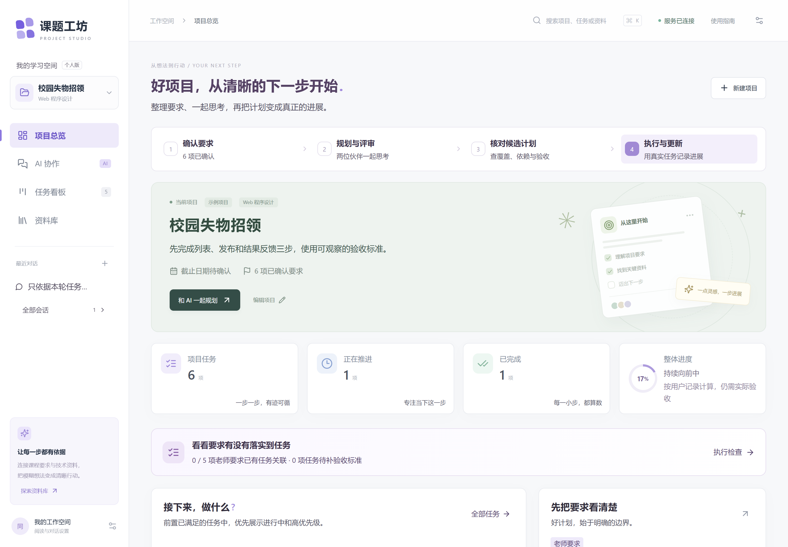

# 课题工坊——基于 RAG 知识库与多智能体协作的课程项目规划系统

面向学生个人项目的规划与知识协作 Web 应用。把项目要求、技术资料、AI 讨论与任务执行放在同一个工作空间，帮助使用者明确范围、形成候选计划，并持续记录实际进展。

项目使用 **HTML、CSS、JavaScript 与 React** 构建前端，使用 **FastAPI 与 SQLite** 提供后端接口和数据存储，通过 **Ollama** 实现模型推理与向量检索。

## 页面预览



*项目总览页面，使用“校园失物招领”示例项目展示需求确认、协作流程、任务进度和执行检查。截图为本地演示状态。*

## 可以做什么

| 模块 | 主要功能 |
| --- | --- |
| 项目总览 | 管理项目目标与要求，查看任务数量、进度和下一步行动 |
| AI 协作 | 资料问答、规划员对话、评审员对话、规划与评审，支持流式输出和历史会话 |
| 任务看板 | 管理任务、状态、优先级、依赖关系、关联要求与验收标准 |
| 资料库 | 分类查找技术参考资料，查看来源、章节与检索依据 |
| 工作空间设置 | 调整字号、对比度、发送快捷键、自动滚动等阅读偏好 |

AI 协作有四种使用模式，包含规划员和评审员两个角色。其中“规划与评审”会形成候选计划，用户核对或人工修订后才能加入任务看板。一般对话不会自动修改任务。模型可以解释代码、提供代码片段，但不会直接修改电脑上的工程文件。

内置“校园失物招领”作为示例项目，用来体验需求整理与任务管理流程；课题工坊自身的主要功能是项目协作。

## 技术与实现

- **前端**：React 19、Vite 6、JavaScript、CSS、Lucide 图标、Markdown 渲染。
- **后端**：Python、FastAPI、Pydantic、HTTPX、Uvicorn。
- **存储**：SQLite 分别保存工作空间业务数据与知识索引，无需另装 MySQL。
- **RAG**：采集公开技术资料，按章节清理和切片，结合向量相似度与关键词检索，保留来源和引用快照。
- **模型通信**：后端连接 Ollama，浏览器通过本项目 API 接收 SSE 流式事件。
- **计划处理**：结构校验、任务依赖检查、要求关联、人工修订与确认入库。
- **可靠性**：会话与运行事件保存、任务版本冲突处理、工作空间导出和数据库备份。

```text
浏览器中的 React 界面
        │ HTTP / SSE
        ▼
FastAPI 后端 ── SQLite 工作空间 / 知识索引
        │
        └── Ollama：对话生成与嵌入向量
```

本仓库包含应用源码、依赖清单、测试与知识库构建脚本。课程报告、演示 PPT、开发记录、个人会话、运行数据库和私有服务配置不随源码发布。知识来源列表与自编项目方法在 `scripts/knowledge_sources.py` 中，供本地重新构建资料索引使用。

## 目录结构

```text
campus-project-studio/
├── backend/                 # Python 后端、RAG 与模型通信
├── frontend/                # React 界面、样式和前端测试
│   ├── src/
│   ├── public/
│   └── package.json
├── scripts/
│   ├── build_knowledge.py   # 采集资料、切片与构建向量索引
│   ├── knowledge_sources.py # 公开资料来源与项目方法
│   └── backup_workspace.py  # 数据库备份与恢复工具
├── tests/                   # 后端测试
├── 启动课题工坊.ps1          # Windows 启动入口
└── README.md
```

## 本地运行

以下命令以 Windows PowerShell 为例。建议安装 Python 3.11 或更高版本、Node.js 22 LTS，以及 Ollama。首次构建知识库需要联网获取公开资料。

### 1. 下载代码并安装依赖

```powershell
git clone https://github.com/Zhenhaoqaz/campus-project-studio.git
cd campus-project-studio

py -3 -m venv .venv
.\.venv\Scripts\python.exe -m pip install -r backend/requirements.lock.txt
npm.cmd --prefix frontend ci
npm.cmd --prefix frontend run build
```

### 2. 准备模型

启动本机 Ollama，并下载默认使用的模型：

```powershell
ollama pull qwen3.5:4b
ollama pull qwen3-embedding:0.6b
```

默认连接 `http://127.0.0.1:11434`。也可在启动后端的终端中设置以下环境变量：

| 环境变量 | 默认值 | 用途 |
| --- | --- | --- |
| `OLLAMA_URL` | `http://127.0.0.1:11434` | 后端可访问的 Ollama 地址 |
| `CHAT_MODEL` | `qwen3.5:4b` | 对话模型 |
| `EMBED_MODEL` | `qwen3-embedding:0.6b` | 嵌入模型；更换后须重建索引 |
| `CAMPUS_DATA_DIR` | 项目根目录下的 `data` | 业务数据库、资料缓存和知识索引目录 |

例如使用其他已安装的对话模型：

```powershell
$env:CHAT_MODEL = '你已安装的模型名称'
```

环境变量由后端读取。项目不包含服务器账号、密码或私有连接脚本，也不会自动登录服务器。`.env` 文件不会自动加载，直接在终端设置环境变量即可。

### 3. 构建知识库

```powershell
.\.venv\Scripts\python.exe scripts/build_knowledge.py
```

脚本从公开来源收集资料，本地切片后通过 Ollama 生成嵌入，保存至独立 SQLite 索引。首次运行所需时间取决于网络、模型和机器性能。索引不随仓库上传，构建完成后才能完整体验资料库与检索问答。

需要重新采集资料时使用 `scripts/build_knowledge.py --refresh`，并建议在应用停止时构建索引。

### 4. 启动应用

```powershell
.\启动课题工坊.ps1
```

浏览器打开 **http://127.0.0.1:18030**。保持终端运行，按 `Ctrl+C` 停止。后端会同时提供构建好的前端页面，日常运行无需打开 VS Code 或 IDEA。

如果 PowerShell 不允许执行脚本，可以直接使用：

```powershell
.\.venv\Scripts\python.exe -m uvicorn backend.app:app --host 127.0.0.1 --port 18030
```

首次启动会创建工作空间数据库和示例项目。Ollama 或知识索引未就绪时，项目管理功能仍可使用，AI 与检索能力需要相应服务准备完成。

## 开发方式

可用 VS Code 打开整个仓库；使用 IDEA 时需要 Python 支持，后端不是 Java / Spring 工程。

开发时先在一个终端启动后端，再在另一个终端启动 Vite：

```powershell
# 终端一：项目根目录
.\.venv\Scripts\python.exe -m uvicorn backend.app:app --host 127.0.0.1 --port 18030 --reload
```

```powershell
# 终端二：项目根目录
npm.cmd --prefix frontend run dev
```

开发页面为 `http://127.0.0.1:5173`，Vite 将 `/api` 请求转发到后端。API 交互文档位于 `http://127.0.0.1:18030/docs`。

## 建议体验流程

1. 打开示例项目，查看目标和已确认要求，也可以新建自己的项目。
2. 在“资料问答”中询问技术问题，展开依据核对资料来源。
3. 使用“规划员对话”讨论范围，使用“评审员对话”检查任务是否具体。
4. 进入“规划与评审”生成候选计划，检查具体工作、依赖和验收标准。
5. 按需人工修订候选版本，确认后加入任务看板。
6. 根据实际工作更新任务状态，再使用执行检查查看要求覆盖和遗漏。

引用和计划检查用于辅助判断；模型输出与“已完成”状态仍需使用者实际核对。项目按本机个人工作空间设计，当前未提供多用户账户与访问鉴权，应在本机环境运行。

## 运行测试

```powershell
.\.venv\Scripts\python.exe -m pytest tests -q
npm.cmd --prefix frontend test
```

测试覆盖接口、切片与检索处理、引用检查、流式事件、任务版本、人工修订及备份等。自动化测试中的模型模拟不能代替真实模型效果评估。
